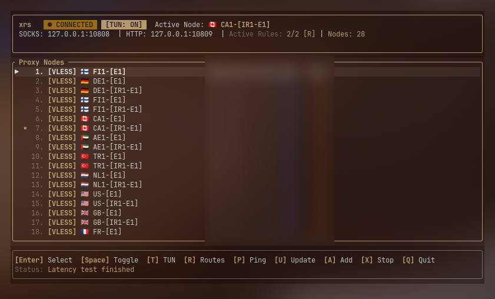

<p align="center">
  
</p>

# xrs

**A lightweight Xray client. Small download. Low memory. Fast control.**

[](https://github.com/mahdjalili/xrs/releases)
[](https://github.com/mahdjalili/xrs/actions/workflows/build.yml)
[](LICENSE)

[Why xrs](#why-xrs) · [Features](#features) · [Install](#install) · [Quick start](#quick-start) · [Omarchy plugin](#omarchy-plugin)



Connect, find a responsive server, and manage your proxy from the terminal. xrs keeps the client small and resource use low, leaving more of your machine for the work you opened it for. Available for Linux and macOS.

## Why xrs

| | xrs |
|---|---:|
| Client binary | **~2.4 MB** |
| Idle memory | **~4.6 MB** |
| Connected memory, including Xray-core | **~44 MB** |
| Idle CPU | **~0.1%** |
| Status check | **~1.5 ms** |

<sub>Measured with xrs v0.10.0 on Ubuntu 24.04, x86_64, with 200 servers. Figures vary by machine and configuration. Binary size is for the client; Xray-core and routing data are downloaded separately.</sub>

- **Small footprint:** a compact client with low memory and CPU use, suited to everyday desktops, remote machines, and ARM boards.
- **Find a responsive server:** compare latency through the proxy, then filter, sort, and switch servers from one screen.
- **Keep control close:** manage connections, subscriptions, and routing with keyboard shortcuts or CLI commands.
- **Choose what uses the proxy:** send selected traffic directly, tunnel it, or block it with routing rules.

## Features

- **Terminal interface:** searchable servers, latency sorting, connection details, mouse support, and colors that follow your terminal theme. Press `?` for shortcuts.
- **Full-system tunnel on Linux:** enable TUN mode to cover applications beyond those with proxy settings. Toggle it with `T` in the interface.
- **Flexible routing:** custom domain and IP rules, bypass lists, and ad and malware blocking. An optional Iran preset sends domestic traffic directly.
- **Links and subscriptions:** import `vless://`, `vmess://`, `trojan://`, and `ss://` links, or sync servers from a subscription URL.
- **DNS settings:** choose separate resolvers for proxied and direct traffic.
- **Background operation:** keep the proxy running after closing the terminal with `xrs start`; stop it with `xrs stop`.
- **Desktop controls:** connect and switch servers from the Omarchy bar with [omaxrs](https://github.com/mahdjalili/omaxrs).

## Install

Download the archive for your machine from the [releases page](https://github.com/mahdjalili/xrs/releases).

| Platform | Archive |
|---|---|
| Linux, Intel / AMD | `linux-amd64` |
| Linux, ARM / Raspberry Pi | `linux-arm64` |
| macOS, Apple Silicon | `macos-arm64` |
| macOS, Intel | `macos-amd64` |

**Linux:**

```bash
tar xzf xrs-*-linux-amd64.tar.gz
install -Dm755 xrs-*-linux-amd64/xrs ~/.local/bin/xrs
xrs install-xray
```

**macOS:**

```bash
tar xzf xrs-*-macos-arm64.tar.gz
mkdir -p ~/.local/bin && cp xrs-*-macos-arm64/xrs ~/.local/bin/xrs
xrs install-xray
```

Replace the archive name if you use a different architecture. Make sure `~/.local/bin` is on your `PATH`.

`xrs install-xray` downloads the Xray engine and routing data. Standard installation stays in your home directory. Linux TUN mode requests elevated permissions for its initial setup and requires an active `systemd-resolved` service with `resolvectl`. On macOS, use proxy mode.

macOS builds are unsigned. If Gatekeeper blocks the first launch, allow it in System Settings → Privacy & Security. Release archives include Sigstore signatures for verification.

## Quick start

Run `xrs`, add a server link or subscription, select a server, and connect. Press `?` to see the available shortcuts.

Prefer commands?

```bash
xrs                          # open the interactive interface
xrs node add "vless://..."    # add a server
xrs sub add "https://..."     # add a subscription
xrs node select              # choose a server
xrs toggle                   # connect / disconnect
xrs tun on                   # enable full-system tunnel mode (Linux)
```

Use `xrs start` to run in the background and `xrs stop` to stop. On Linux with systemd, the background service can start automatically when you log in.

## Omarchy plugin

[omaxrs](https://github.com/mahdjalili/omaxrs) adds connection controls and server switching to the Omarchy Quattro bar. See its README for installation.

## License

MIT, see [LICENSE](LICENSE).
